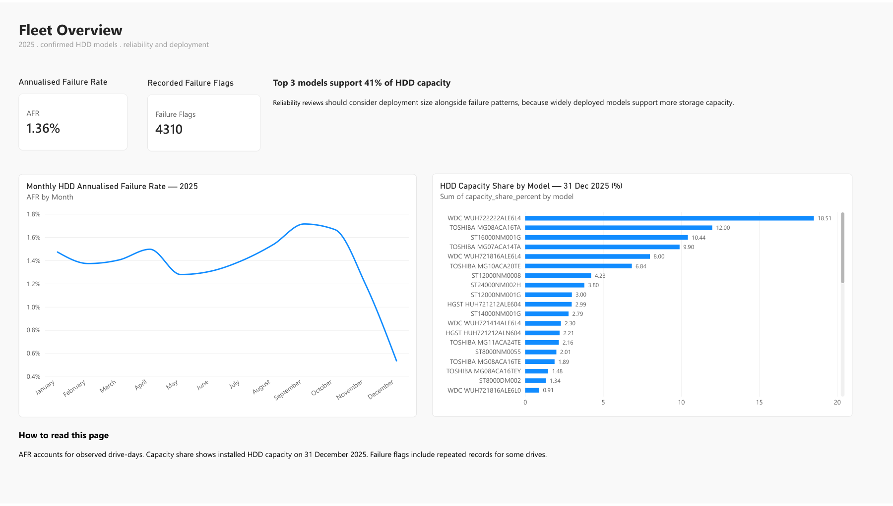
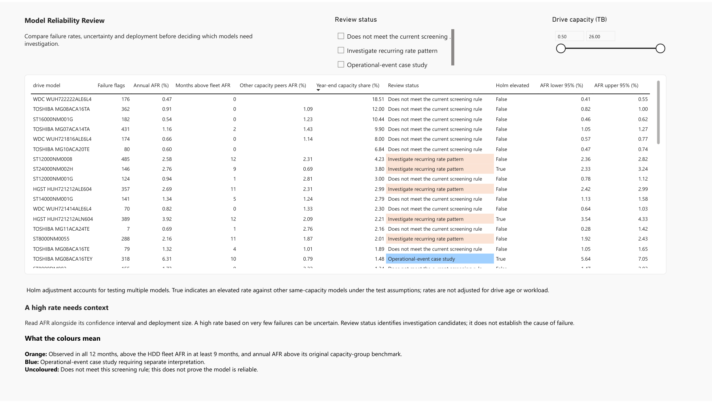
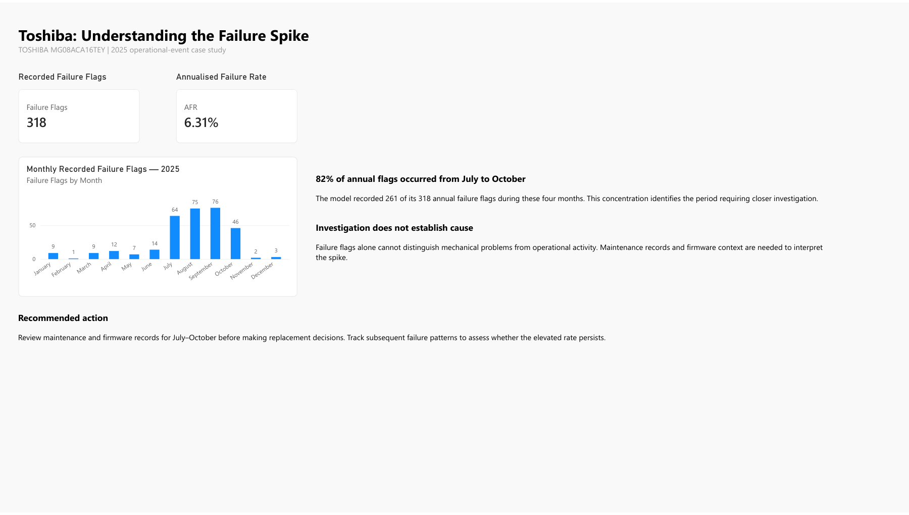
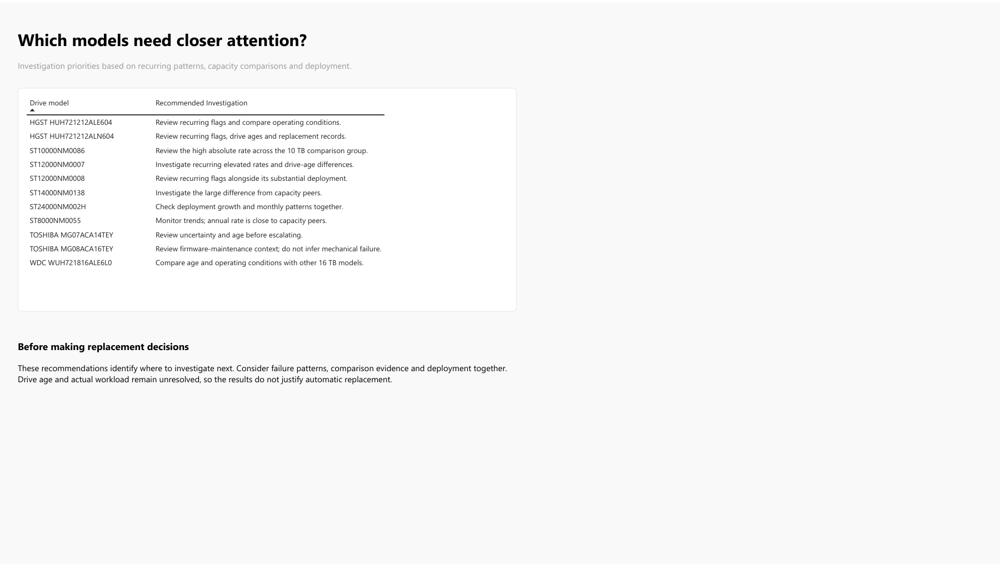
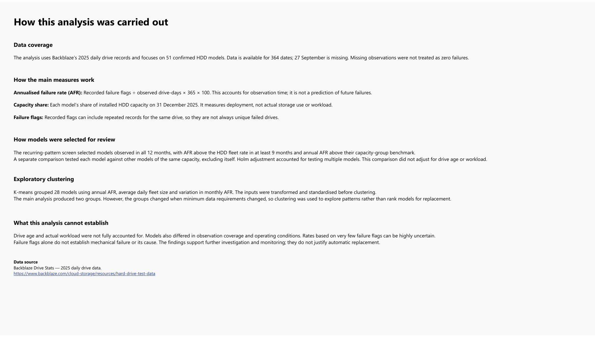

# Backblaze: Drive Reliability & Capacity Analysis

**Which drive models need closer attention, and why?**

**Python · Statistical analysis · Power BI · Business recommendations**  
An independent portfolio project by Bhavya Rajyaguru | 2025 Drive Stats data

[Dashboard preview](#dashboard-preview) · [Key findings](#key-findings) · [Recommendations](#business-recommendations) · [Methods and code](#methods-and-reproducibility) · [View dashboard PDF](reports/dashboard.pdf)

---

## Project overview

I used Backblaze’s 2025 drive records to find models that may need closer attention. I looked at failure rates, monthly patterns and the number of drives in use. I also checked how much data supported each result.

The main question was:

> **Which drive models need closer attention based on their failure patterns and how much they are used?**

I prepared and analysed the data in Python. I compared models of the same capacity, checked uncertainty and explored groups with similar patterns. I then built a five-page Power BI report to explain the findings and suggest what to review next.

| Annual HDD AFR | Recorded failure flags | Models for investigation | Capacity supported by top 3 models |
| :---: | :---: | :---: | :---: |
| **1.36%** | **4,310** | **11** | **40.95%** |

The results show why a failure rate needs context. Before taking action, it helps to check whether the pattern repeats, how many drives are involved and whether maintenance affected the records.

## Why this question matters

Drive replacement costs money. Leaving a recurring problem unchecked can also create risk. This project helps identify which models need more review and what information would help that review.

The result is a shortlist for investigation. The recommendations have not been implemented, and no cost savings have been measured.

Here, “used” means how widely a model is **deployed**. I measured this through drive counts, drive-days and installed capacity. I did not measure the actual read/write workload. A failure flag is a recorded marker in the data; it does not always mean a separate physical failure.

## Dashboard preview

### 1. Fleet Overview

Shows the overall failure rate, monthly changes and each model’s share of installed HDD capacity.



### 2. Model Review

Compares each model’s failure rate, uncertainty, monthly patterns and capacity share. Filters let the reader choose a review status or drive capacity.



### 3. Toshiba Case Study

Looks at the Toshiba model’s failure spike. It shows when the flags occurred and explains why maintenance records matter.



### 4. Recommendations

Lists the next steps for the 11 models selected for review.



<details>
<summary><strong>5. Methodology & Limitations — view the dashboard page</strong></summary>



</details>

*These previews come from the supplied PDF export. Scrolling tables may show only their visible rows. Two minor text corrections have been applied to this export.*

## Key findings

### 1. Three models support about 41% of HDD capacity

The three models with the largest shares support **40.95% of year-end HDD capacity**. This helps show the scale of each model’s deployment. It measures installed capacity, not how much data is stored.

### 2. Eleven models met the review rules

I selected models that appeared in all 12 months, had a monthly AFR above the HDD fleet rate in at least nine months and had an annual AFR above their original capacity-group benchmark.

Ten models showed recurring patterns that need review. **I treated Toshiba MG08ACA16TEY separately because of its operational context.** A model that did not meet these rules is not automatically reliable.

### 3. Six models had higher rates than their same-capacity peers

I also compared each model with the other models of the same capacity. I excluded the model itself from its comparison group. Six models had higher rates with **Holm-adjusted p-values below 0.05**. Holm adjustment accounts for testing several models.

| Model | Annual AFR | Other same-capacity peers’ AFR |
| --- | ---: | ---: |
| HGST HUH721212ALN604 | 3.92% | 2.09% |
| ST12000NM0007 | 5.49% | 2.35% |
| ST14000NM0138 | 5.33% | 1.17% |
| ST24000NM002H | 2.76% | 0.69% |
| TOSHIBA MG08ACA16TEY | 6.31% | 0.79% |
| WDC WUH721816ALE6L0 | 1.98% | 1.00% |

These results support further review. They do not prove a mechanical defect. Drive age, workload and operational events were not adjusted for.

### 4. Toshiba shows why context matters

Toshiba MG08ACA16TEY recorded **318 annual flags and a 6.31% AFR**. July–October accounted for **261 flags—about 82% of the annual total**.

Backblaze’s [Q3 2025 report](https://www.backblaze.com/blog/backblaze-drive-stats-for-q3-2025/) explains that firmware work required pulling some drives and contributed to the model’s unusually high recorded failures. My analysis shows when the flags occurred. It cannot establish the cause of each flag.

### 5. Extra checks showed how the results change

| Check | What I found |
| --- | --- |
| Repeated flags | 4,310 flags covered 4,294 unique serial numbers. Counting each serial once changed no model AFR rankings |
| Partial coverage on 12 May | Excluding that date changed model AFR by at most about 0.0177 percentage points |
| Exploratory K-means | Two groups were preferred for 28 models. Changing the minimum drive-days changed the groups |

Clustering helped me explore similar patterns. It does not show whether a model is safe or unsafe. For the repeated-flag check, I changed the failure count and kept drive-days the same. This is not a first-failure survival analysis.

## Business recommendations

| Evidence | Suggested next step |
| --- | --- |
| Repeated high rates | Review drive ages, operating conditions and replacement records |
| Higher rates than same-capacity models | Check the difference under similar ages and operating conditions |
| A widely deployed model | Consider its installed capacity alongside the failure pattern |
| Toshiba’s concentrated spike | Review July–October maintenance and firmware records, then monitor subsequent patterns |
| A high rate based on few flags | Check the confidence interval and amount of data before taking action |

The recommendations identify where to investigate next. They do not justify automatic replacement.

## What I built and learned

- Python scripts that turn daily records into model summaries and Power BI input files.
- Checks for missing dates, unknown model types, partial coverage and repeated flags.
- Failure rates based on drive-days, confidence intervals and model comparisons.
- A five-page report covering the fleet, model review, Toshiba case, recommendations and methods.

I learned to look beyond a single rate. Even when rankings stay the same, the results can still be uncertain. A higher rate also needs an explanation before it can support a replacement decision.

## Project files

| Folder or file | What it contains |
| --- | --- |
| `README.md` | Project overview, findings and instructions |
| `code/` | Seven Python scripts, shared settings and package list |
| `results/` | Selected model summaries, checks and investigation actions |
| `images/` | Five dashboard previews |
| `reports/dashboard.pdf` | The five-page Power BI export |

The raw daily files and large drive-level extracts are not included. Download the source data from Backblaze to run the full analysis. 

## Methods and reproducibility

Open the section below for the data details, methods, script order, output files and checks.

<details>
<summary><strong>Open the technical documentation and running instructions</strong></summary>

### Data and scope

Source: [Backblaze Drive Stats dataset](https://www.backblaze.com/cloud-storage/resources/hard-drive-test-data).

The files I analysed contain 80 model labels. I classified 51 as HDD and 19 as SSD, and left 10 as unknown. The main analysis focuses on the 51 HDD models.

- 365 CSV files were found, with 364 distinct usable dates.
- 27 September 2025 is missing from the supplied dataset.
- An empty duplicate file for 1 January was excluded.
- Missing observations were not treated as zero failures.
- The HDD analysis contains 115,720,549 observed drive-days.
- Capacity share uses the observed snapshot on 31 December 2025.

These figures come from the files and counting rules used in this project. Backblaze’s published annual report uses its own rules for including drives and reviewing failures, so the results are not directly interchangeable.

### Analytical approach

#### 1. Prepare and audit daily records

I started by checking the files, dates and columns, then cleaned the main fields and created daily and monthly summaries. I kept a record of excluded files and data issues. I handled capacity checks separately: a record with an invalid capacity could still contribute to the failure-rate analysis if its other required fields were usable.

#### 2. Classify drive models

I used a model mapping to separate HDDs, SSDs and unknown labels. I left uncertain labels as unknown instead of guessing from their capacity or part of their name. The mapping is saved in `model_classification.csv`; it has not been independently certified by the manufacturers.

#### 3. Calculate exposure-based rates and uncertainty

**AFR (%) = recorded failure flags ÷ observed drive-days × 365 × 100**

One drive observed for one day adds one drive-day. To calculate the fleet rate, I divided the total flags by the total drive-days. I did not simply average the individual model rates.

I added Poisson 95% confidence intervals to show how uncertain each rate is. Models with little data can have very wide intervals. AFR expresses the recorded rate on a yearly scale; it does not predict whether an individual drive will fail next year.

#### 4. Screen recurring monthly patterns

The recurring-pattern screen selects models that:

1. Were observed in all 12 months.
2. Had monthly AFR above the HDD fleet rate in at least nine months.
3. Had annual AFR above their original capacity-group benchmark.

This screen selected 11 models. I kept Toshiba MG08ACA16TEY as a separate case because Backblaze’s published explanation adds important context to its spike. The other ten models are labelled for investigation of recurring patterns.

For this first screen, the capacity-group rate includes the model being checked. In the next comparison, I remove the model from its own comparison group.

#### 5. Compare other models of the same capacity

I then compared each model with the other models of the same capacity, excluding itself. I used a conditional binomial test based on failure counts and drive-days. Because I tested several models, I applied Holm adjustment to the tests that could be calculated.

Six models have higher rates than their other same-capacity peers with adjusted p-values below 0.05:

| Model | Annual AFR (%) | Other same-capacity peers’ AFR (%) |
| --- | ---: | ---: |
| HGST HUH721212ALN604 | 3.92 | 2.09 |
| ST12000NM0007 | 5.49 | 2.35 |
| ST14000NM0138 | 5.33 | 1.17 |
| ST24000NM002H | 2.76 | 0.69 |
| TOSHIBA MG08ACA16TEY | 6.31 | 0.79 |
| WDC WUH721816ALE6L0 | 1.98 | 1.00 |

These tests rely on assumptions about the failure counts and exposure. They do not adjust for age, workload, operational events or every source of dependence between records. A significant result is a reason to investigate; it does not prove a mechanical defect.

#### 6. Explore model groups with K-means

I used K-means to look for groups with similar annual AFR, average daily fleet size and variation in monthly AFR. I applied `log1p` transformations and standardised the features before clustering.

I included models with at least 180 observed dates and 100,000 drive-days, which left 28 models. I tested two to five groups. Two groups had the best silhouette score. The results were stable across ten random starts, but changing the minimum exposure requirement changed the preferred grouping.

I therefore used clustering to explore patterns, not to rank models for replacement. These groups are also different from the physical storage locations recorded in the dataset’s `cluster_id` field.

#### 7. Check robustness and repeated flags

| Check | Result |
| --- | --- |
| Repeated failure flags | 16 extra flags across seven models |
| Alternative unique-serial numerator | No model AFR rankings changed |
| Largest rate difference from alternative numerator | 0.1389 percentage points for Toshiba MG08ACA16TEY |
| Excluding the partial-coverage date, 12 May | Largest AFR change approximately 0.0177 percentage points |
| Monthly screen threshold | Candidate counts change as the required number of above-fleet months changes |
| Clustering eligibility | Group assignments are sensitive to exposure requirements |

For the repeated-flag check, I changed the numerator and kept drive-days unchanged. This shows how the counting choice affects the rates. It is not a survival analysis of the first failure of each drive.

### Reproduce the Python analysis

Keep the seven scripts, `config.py` and `requirements.txt` together. Obtain the 2025 daily source files from Backblaze and keep generated results outside the raw-data folder.

Default folders in `config.py`:

- Raw data: `~/Desktop/Backblaze_Data`
- Results: `~/Desktop/Backblaze_Organised_Results`

The raw folder should contain only the intended 2025 daily source files. Adjust `config.py` or the `BACKBLAZE_RAW` and `BACKBLAZE_OUTPUT` environment variables for a different machine.

From the main project folder, open `code`, install the packages and run each script in order:

```bash
cd code
python3 -m pip install -r requirements.txt
python3 01_prepare_data.py
python3 02_classify_models.py
python3 03_annual_reliability.py
python3 04_toshiba_patterns.py
python3 05_capacity_and_screening.py
python3 06_remaining_analysis.py
python3 07_repeated_flag_audit.py
```

Scripts 04 and 07 read raw records and can take longer. Some extracts are reused on later runs. If the source data changes, use a fresh output folder and rebuild to avoid mixing cached extracts with new summaries.

| Script | Main responsibility |
| --- | --- |
| `01_prepare_data.py` | File audit, cleaning, daily/monthly summaries and capacity pairs |
| `02_classify_models.py` | Explicit drive-type classification |
| `03_annual_reliability.py` | Annual HDD rates and confidence intervals |
| `04_toshiba_patterns.py` | Monthly, location and July cohort exploration |
| `05_capacity_and_screening.py` | Capacity shares, recurring screen, coverage sensitivity and actions |
| `06_remaining_analysis.py` | Independent peers, Holm adjustment, clustering and baseline evidence |
| `07_repeated_flag_audit.py` | Repeated serial histories and numerator sensitivity |

### Main output files

| Output | Contents |
| --- | --- |
| `daily_model_summary.csv` | Daily model exposure, flags and capacity summaries |
| `model_classification.csv` | Model type and capacity mapping |
| `hdd_comparison.csv` | Annual HDD AFR and 95% intervals |
| `capacity_reliability.csv` | Year-end capacity and reliability evidence |
| `model_investigation_actions.csv` | Final 11 model-specific actions |
| `remaining_analysis/review_with_additional_evidence.csv` | Full 51-model review with peer and clustering evidence |
| `remaining_analysis/independent_capacity_peers.csv` | Leave-one-out peer rates and adjusted comparisons |
| `remaining_analysis/cluster_sensitivity.csv` | Sensitivity of clustering to eligibility rules |
| `failure_count_sensitivity.csv` | Recorded flags versus unique-serial numerator |
| `file_inventory.csv`, `coverage.json` | File and date coverage audit |

`investigation_shortlist.csv` is an earlier five-model exploratory output retained by the workflow. Use `model_investigation_actions.csv` for the final 11-candidate actions.

### Validation

All seven scripts completed on the source machine on 31 October 2026. The final results archive was compared with the previously checked reference outputs: all 40 CSV files matched within numerical tolerance, allowing for CSV data types. The code also passed syntax checks, and preparation was checked with a small synthetic fixture covering file and record issues.

These checks confirm that the scripts ran and the outputs stayed consistent for the supplied data. They do not independently verify every classification, assumption or operational explanation.


</details>

## Limits to keep in mind

Drive age and actual workload were not fully accounted for. Models differ in observation coverage and operating conditions. Installed capacity does not measure stored data or business-critical workload. Tests and confidence intervals rely on statistical assumptions, and recorded flags are not always independent physical failures.

These figures come from the files and rules used in this project. Backblaze’s published annual report uses its own review rules, so the figures may differ.

## Sources and author

- [Backblaze Drive Stats dataset and documentation](https://www.backblaze.com/cloud-storage/resources/hard-drive-test-data)
- [Backblaze Q3 2025 report and Toshiba operational context](https://www.backblaze.com/blog/backblaze-drive-stats-for-q3-2025/)

**Bhavya Rajyaguru** · MSc Business Analytics, Queen’s University Belfast – GIFT City campus

Independent portfolio analysis. Not affiliated with or endorsed by Backblaze. Data source: Backblaze.

[Download the Power BI report (.pbix)](Backblaze%20Drive%20Reliability%20and%20Capacity%20Analysis-2.pbix)

Open this file in Power BI Desktop to explore the report.
